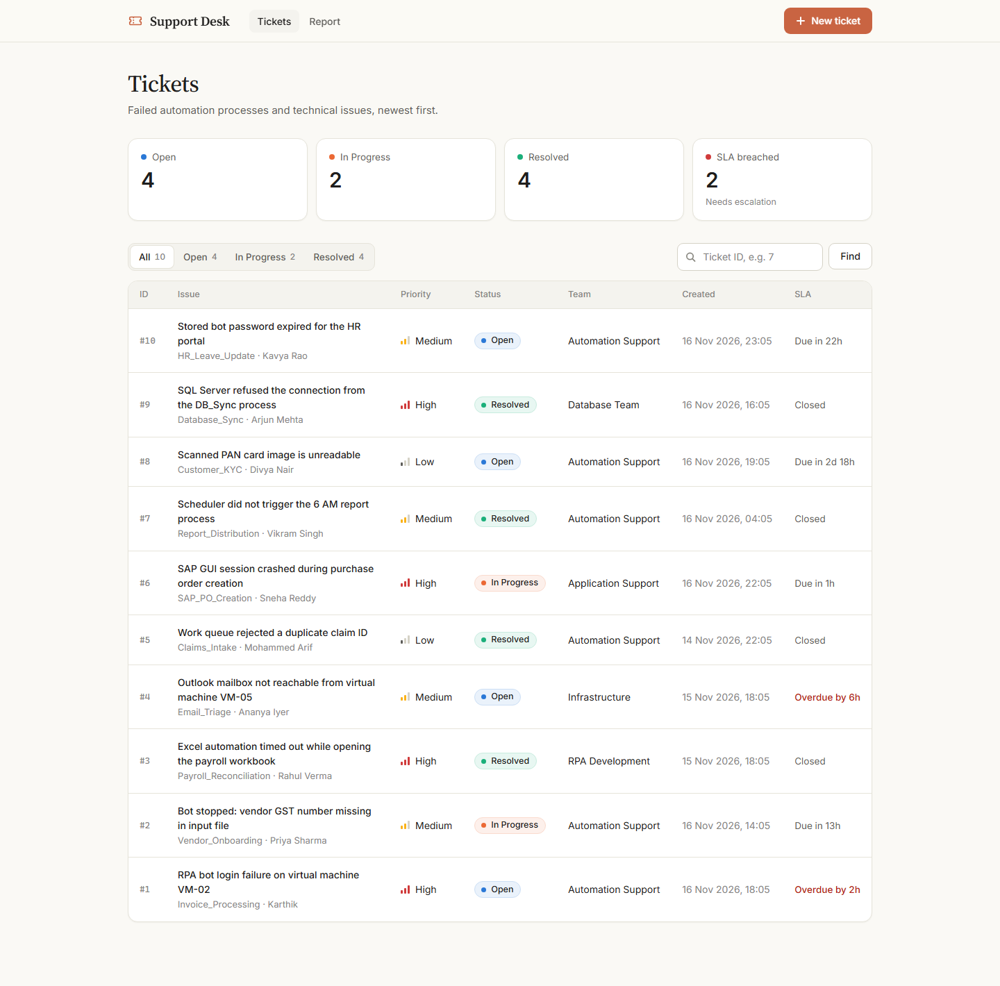
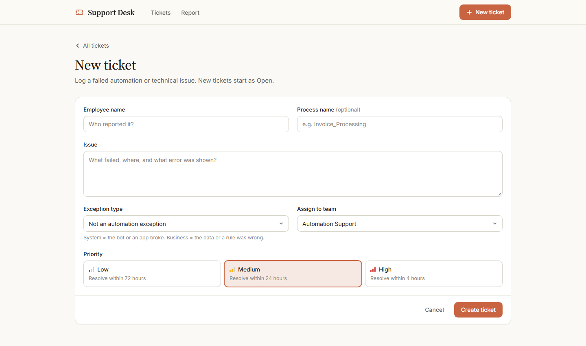
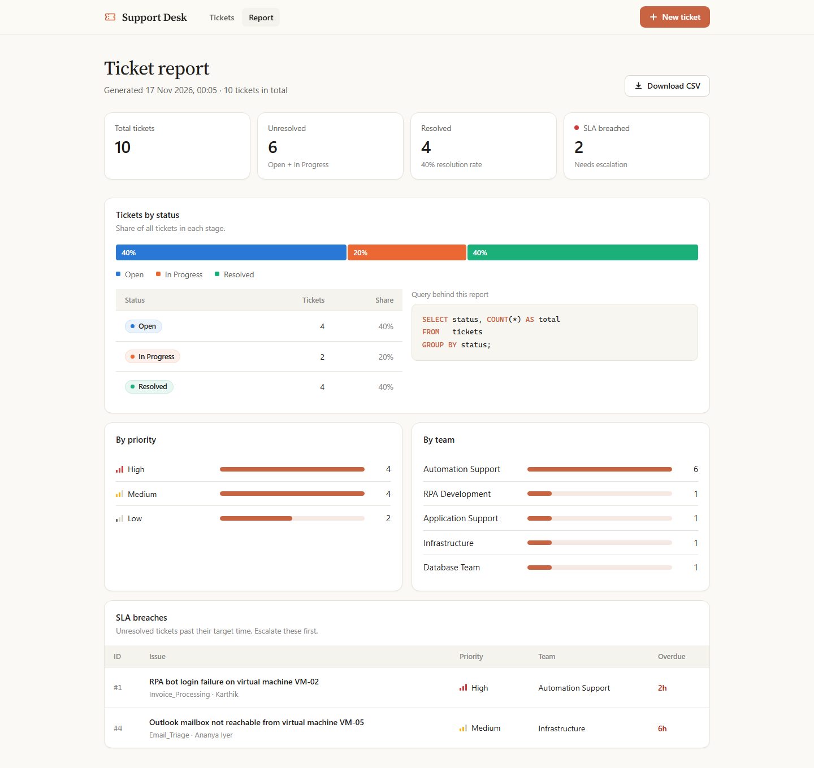

# Support Desk: IT Support Ticket Management System

A small web app for an IT / RPA support engineer to log failed automation processes,
track them from **Open → In Progress → Resolved**, assign them to the right team and
report on SLA breaches. Built with **Python, Flask and SQLite**.



## Features

| Feature          | Where                                                                           |
| ---------------- | ------------------------------------------------------------------------------- |
| Create ticket    | **New ticket** button: employee, process, issue, exception type, priority, team |
| View tickets     | **Tickets** page: every ticket, newest first, filter by status                  |
| Search ticket    | Search box on the Tickets page: type a ticket ID such as `7` or `#7`            |
| Update status    | Open a ticket and choose Open / In Progress / Resolved                          |
| Assign team      | Chosen when creating, can be changed on the ticket page                         |
| Priority         | Low / Medium / High, each with an SLA (72h / 24h / 4h)                          |
| Generate report  | **Report** page: counts by status, priority and team, SLA breaches, CSV export  |

Extra support-desk rules:

- A ticket can't be marked **Resolved** without resolution notes.
- Any unresolved ticket past its SLA is flagged **Overdue** and listed for escalation.
- Tickets record the automation **process name** and **exception type**
  (System Exception = the bot or an application failed; Business Exception = the data or a business rule was wrong).

## How to run

1. Install Python 3.10 or newer from [python.org](https://www.python.org/downloads/) (tick **Add Python to PATH**).
2. In this folder, install Flask and start the app:

   ```bash
   pip install -r requirements.txt
   python main.py
   ```

3. Open <http://127.0.0.1:5000>.

The first run creates `support_tickets.db` and loads 10 sample tickets.
To start fresh, stop the app, delete `support_tickets.db` and run it again.

## Project structure

```text
├── main.py              Flask web app: URLs, form validation, SLA logic
├── database.py          All SQL: create table, insert, select, update, group by
├── support_tickets.db   SQLite database (created on first run)
├── requirements.txt     The one library needed: Flask
├── templates/
│   ├── base.html        Shared layout and the full stylesheet (light + dark mode)
│   ├── index.html       Tickets list, status filter, search
│   ├── new.html         Create-ticket form
│   ├── ticket.html      One ticket: details and update form
│   └── report.html      Report: status split, priority, team, SLA breaches
└── screenshots/
```

## Database

Table `tickets` in `support_tickets.db`:

| Column           | Type                | Notes                                               |
| ---------------- | ------------------- | --------------------------------------------------- |
| ticket_id        | INTEGER PRIMARY KEY | Assigned automatically by SQLite                    |
| employee_name    | TEXT                | Required                                            |
| issue            | TEXT                | Required                                            |
| priority         | TEXT                | `CHECK` Low / Medium / High                         |
| status           | TEXT                | `CHECK` Open / In Progress / Resolved, default Open |
| assigned_team    | TEXT                | Required                                            |
| created_date     | TEXT                | Defaults to the current local date and time         |
| resolution_notes | TEXT                | Filled in when resolving                            |
| process_name     | TEXT                | Extra: the automation process that failed           |
| exception_type   | TEXT                | Extra: System or Business Exception                 |

## SQL used

```sql
-- Create a ticket
INSERT INTO tickets (employee_name, issue, priority, status, assigned_team, process_name, exception_type)
VALUES (?, ?, ?, 'Open', ?, ?, ?);

-- View all tickets / search by ID
SELECT * FROM tickets ORDER BY ticket_id DESC;
SELECT * FROM tickets WHERE ticket_id = ?;

-- Unresolved tickets (used for SLA breaches)
SELECT * FROM tickets WHERE status != 'Resolved';

-- Update a ticket
UPDATE tickets
SET status = ?, priority = ?, assigned_team = ?, resolution_notes = ?
WHERE ticket_id = ?;

-- Report
SELECT status, COUNT(*) AS total FROM tickets GROUP BY status;
```

Every value goes in through a `?` placeholder, never pasted into the SQL string,
which protects the app from SQL injection.

## Screenshots

| Create ticket                                   | Ticket report                            |
| ----------------------------------------------- | ---------------------------------------- |
|  |  |
